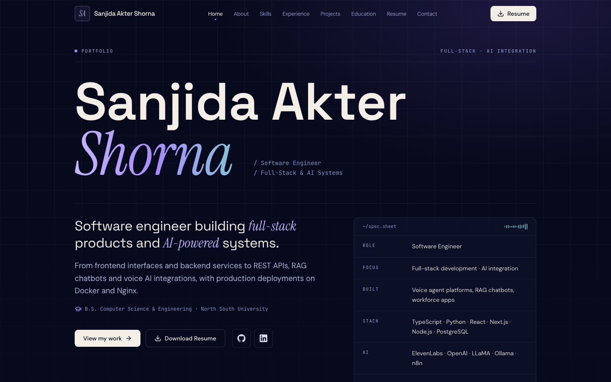
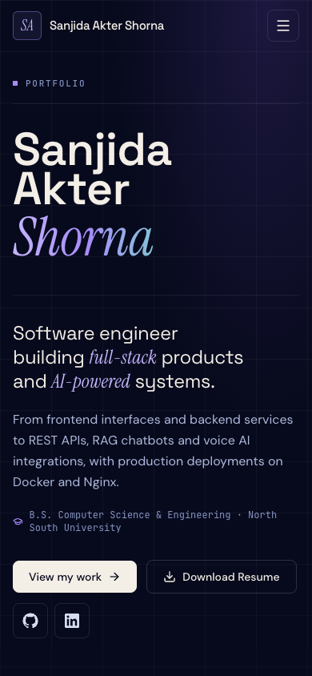
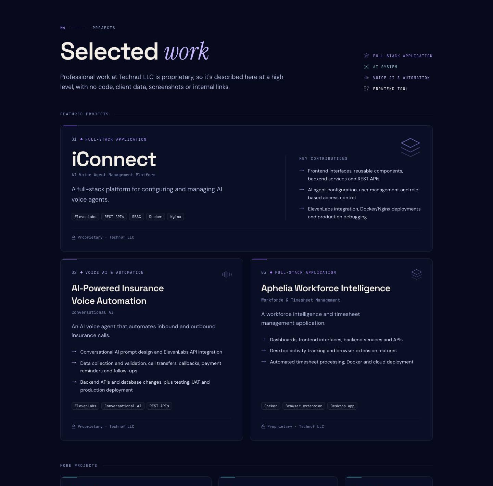

# Sanjida Akter Shorna — Developer Portfolio

[](https://sanzidaaktershorna2001-ctrl.github.io/portfolio/)
[](https://github.com/sanzidaaktershorna2001-ctrl/portfolio/actions/workflows/deploy-pages.yml)

Personal portfolio of a Software Engineer focused on full-stack development and AI integration.
Built with **Next.js 15, React 19, TypeScript and Tailwind CSS v4**, exported as a static site and
deployed to **GitHub Pages** through GitHub Actions.

**Live:** https://sanzidaaktershorna2001-ctrl.github.io/portfolio/

<p>
  
  &nbsp;
  
</p>

## Features

- **Single content file.** Every piece of text (experience, projects, skills, education, links)
  lives in [`src/data/portfolio.ts`](src/data/portfolio.ts). Components only handle layout.
- **Editorial type system.** Space Grotesk (display), Instrument Serif (accents), DM Sans (body) and
  JetBrains Mono (labels), self-hosted at build time with `next/font`.
- **Bento project grid** with category colors and line-art glyphs (full-stack, AI system,
  voice AI & automation, frontend tool), so project types read at a glance.
- **Purposeful motion.** Scroll-reveal, a pointer-tracking grid spotlight in the hero and hover
  micro-interactions, all disabled under `prefers-reduced-motion`. Content stays visible without JavaScript.
- **Responsive and accessible.** Tested at 1440, 1024, 820 and 390 px; skip link, focus rings,
  ARIA labels and active-section highlighting in the navbar.
- **Résumé download** that enables itself only when `public/resume.pdf` exists at build time,
  so the site never ships a broken link.
- **Clean URLs.** Tracking parameters (`utm_*`, `gclid`, `fbclid`, …) are removed from the address bar
  with `history.replaceState()` before render.
- **Static export + CI/CD.** `output: "export"` with a configurable `basePath`; a GitHub Actions workflow
  builds and publishes on every push to `main`.



## Tech stack

| Area | Tools |
| --- | --- |
| Framework | Next.js 15 (App Router, static export), React 19 |
| Language | TypeScript |
| Styling | Tailwind CSS v4 (design tokens in `@theme`) |
| Icons & fonts | lucide-react, `next/font` (Google Fonts, self-hosted) |
| Quality | ESLint, `tsc --noEmit` |
| Hosting | GitHub Pages via GitHub Actions (Docker + Nginx config also included) |

## Architecture

```
src/data/portfolio.ts  ──►  React section components  ──►  next build (static export)
   (all content)            (layout & interaction only)        │
                                                               ▼
                         GitHub Actions: npm ci → build → upload-pages-artifact → deploy-pages
```

```
src/
  app/          layout.tsx (fonts, metadata, inline URL-cleanup script), page.tsx, globals.css, robots, sitemap
  components/   Navbar, Hero (+ HeroSpotlight, HeroVisual), About, Skills, Experience,
                Projects (+ ProjectMotif), Education, Resume, Contact, Footer, Reveal, SectionHeading
  data/         portfolio.ts (the only file to edit for content)
  lib/          resume.ts (build-time check for public/resume.pdf)
public/         resume.pdf, .nojekyll
.github/        workflows/deploy-pages.yml
```

> Professional projects shown on the site (Technuf LLC) are described at a high level only.
> This repository contains no employer code, client data, internal URLs or credentials.

## Run locally

Requires Node.js 18.18+ (20 or 22 recommended).

```bash
git clone https://github.com/sanzidaaktershorna2001-ctrl/portfolio.git
cd portfolio
npm install
npm run dev            # http://localhost:3000
```

| Script | What it does |
| --- | --- |
| `npm run dev` | Dev server with hot reload |
| `npm run build` | Production build |
| `npm run lint` | ESLint |
| `npm run typecheck` | TypeScript check |

**Preview the GitHub Pages build:**

```bash
STATIC_EXPORT=1 NEXT_PUBLIC_BASE_PATH=/portfolio npm run build   # static site in ./dist
```

## Deployment

**GitHub Pages (current).** [`.github/workflows/deploy-pages.yml`](.github/workflows/deploy-pages.yml)
builds a static export and publishes it on every push to `main`. The sub-path and site URL are read from
the Pages configuration, so a fork works without edits: enable *Settings → Pages → Source: GitHub Actions*
and push.

**Other hosts.**

- *Vercel:* import the repo; no configuration needed.
- *Netlify / Cloudflare Pages / S3:* build command `STATIC_EXPORT=1 npm run build`, publish directory `dist`.
- *Docker + Nginx:* `docker build -t portfolio . && docker run -p 8080:80 portfolio`.

## Editing content

- **Text, links, experience, projects, skills:** [`src/data/portfolio.ts`](src/data/portfolio.ts).
  Wrap words in `*asterisks*` in section titles to render them in the serif accent.
- **Résumé:** replace `public/resume.pdf` and push.
- **Colors, fonts, motion:** the `@theme` block in [`src/app/globals.css`](src/app/globals.css).
